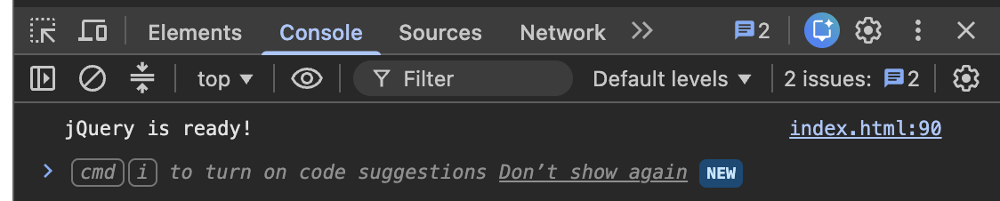
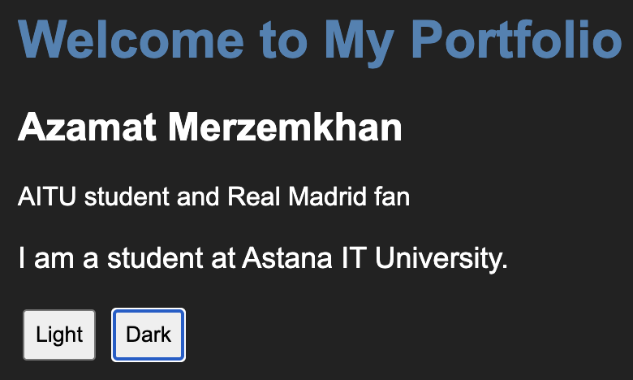
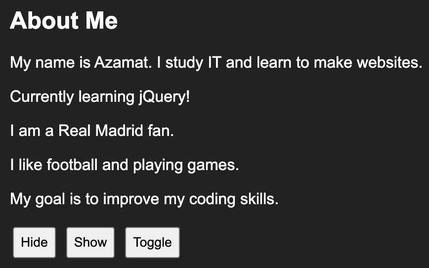
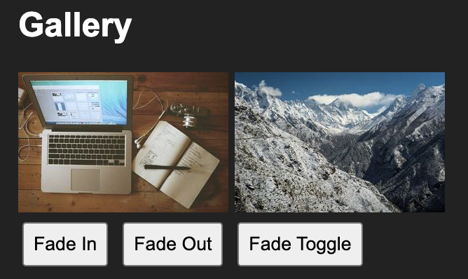
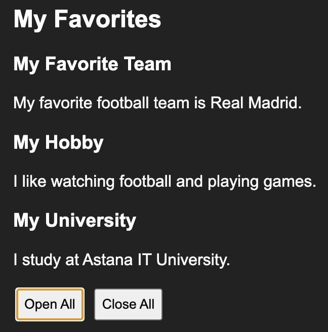
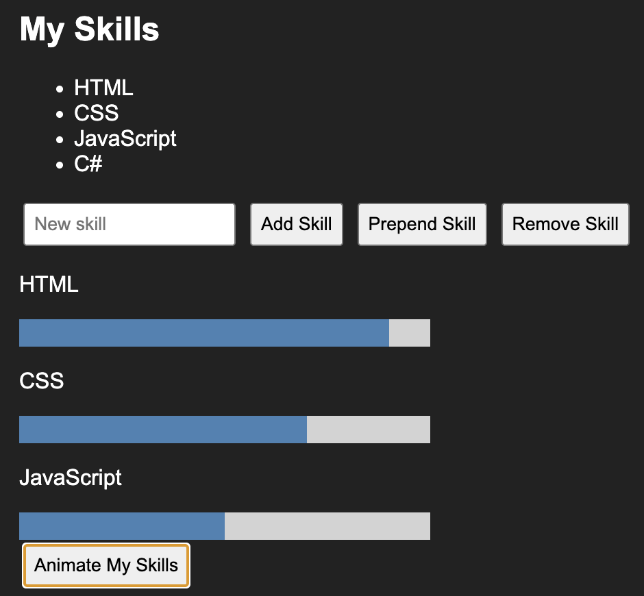
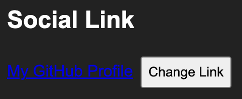
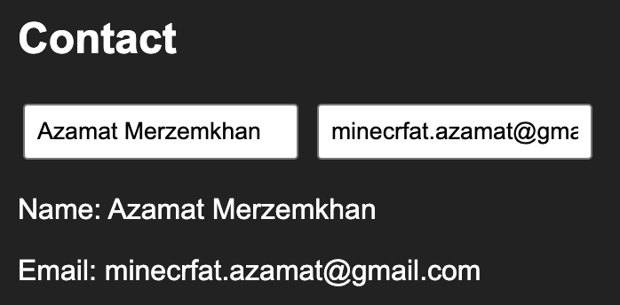
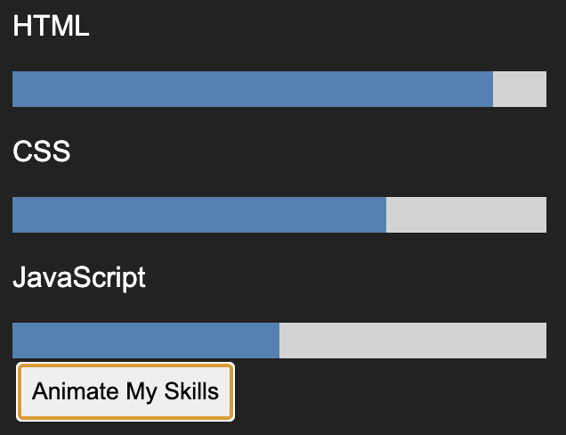

# Assignment 6 — jQuery

Azamat Merzemkhan  
Group: IT-2513

## Task 0. Setup
Added jQuery CDN and printed "jQuery is ready!" in the console.

## Task 1. Selectors and CSS
Used tag, ID and class selectors, changed text and added light/dark themes.

## Task 2. Visibility
Added Hide, Show and Toggle buttons for the About Me section.

## Task 3. Fade
Added two images with fadeIn, fadeOut and fadeToggle.

## Task 4. Slide
Added three panels with slideToggle, slideDown and slideUp.

## Task 5. Skills
Used append, prepend and remove. Empty skills cannot be added.

## Task 6. Attributes
Changed the GitHub link using attr.

## Task 7. Form
Displayed Name and Email live using val and text.

## Task 8. Animation
Animated three skill bars to different widths and back to zero.

## Work process
First I made the HTML page, then added basic CSS and jQuery events.# web6
